<div align="center">
  
</div>

<p align="center">
  <a href="https://www.linkedin.com/in/ayyoub-sghuri-2b65a627a/"></a>
  <a href="mailto:ayyoub.sghuri@gmail.com"></a>
  <a href="https://www.youtube.com/@TheXDNHOOPedits"></a>
  <a href="https://github.com/Ayyoubsghuri/AyyoubSghuri/blob/main/Resume.pdf"></a>
</p>

---

### `~/about` &nbsp;$ `cat whoami.py`

```python
class AyyoubSghuri:
    role      = "Full-Stack Developer"
    location  = "Morocco 🇲🇦"
    languages = ["Python", "C#", "Java", "JavaScript"]
    focus     = ["Full-Stack Development", "Python Engineering"]
    learning  = ["Data Science", "Machine Learning"]
    portfolio = "coming soon..."

    def mission(self):
        return "turning ideas into clean, scalable code"
```

### `~/about` &nbsp;$ `./status --now`

```diff
+ [ok]    building scalable web apps end to end
+ [ok]    shipping backends with Django and .NET
+ [ok]    crafting UIs with React + Tailwind
! [wip]   leveling up in Data Science & ML
+ [ok]    automating the boring stuff with Selenium
# [free]  editing hoop highlights on YouTube
```

---

### `~/stack` &nbsp;$ `tree -L 2`

```text
~/stack
├── languages
│   ├── python
│   ├── csharp
│   ├── java
│   └── javascript
├── backend
│   ├── django
│   └── .net
├── frontend
│   ├── react
│   └── tailwindcss
├── databases
│   ├── mysql
│   └── sqlite
├── devops
│   ├── docker
│   ├── aws
│   ├── git
│   └── heroku
└── data-ai
    ├── pandas
    ├── numpy
    ├── opencv
    ├── selenium
    └── anaconda

6 directories, 19 files
```

<p align="center">
  
</p>

---

### `~/contact` &nbsp;$ `ping ayyoub`

```bash
PING ayyoub (morocco) 56 bytes of data.
64 bytes from linkedin: reply=open_to_collab   time=fast
64 bytes from gmail:    reply=ayyoub.sghuri@gmail.com
64 bytes from github:   reply=@Ayyoubsghuri

--- ayyoub ping statistics ---
3 packets transmitted, 3 received, 0% packet loss
```

<p align="center">
  <a href="https://www.linkedin.com/in/ayyoub-sghuri-2b65a627a/"></a>&nbsp;
  <a href="mailto:ayyoub.sghuri@gmail.com"></a>&nbsp;
  <a href="https://github.com/Ayyoubsghuri"></a>
</p>

---

<p align="center">
  <code>$ exit</code> &nbsp;·&nbsp; <sub>© 2026 Ayyoub Sghuri — built with ❤️ and code</sub> &nbsp;·&nbsp;
  
</p>
